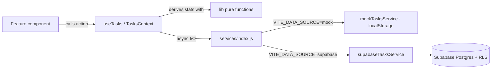

# Architecture

## 1. Technology Stack

**Frontend**
- React with Vite. JavaScript and JSX only; no TypeScript.
- Tailwind CSS v4, through the official `@tailwindcss/vite` plugin, with `@import "tailwindcss";` in CSS.
- React Router in declarative mode (D-16).
- Lucide React for icons.
- Recharts for charts (Phase 4, lazy-loaded; NFR-03).

**Backend (Phase 5)**
- Supabase: PostgreSQL, Supabase Auth, Row Level Security.
- `@supabase/supabase-js` as the only backend client library.

**Tooling**
- ESLint (flat config from the Vite template).
- Vitest, React Testing Library, `@testing-library/user-event`, and jsdom (Phase 3).
- Git, with GitHub as the remote.
- Vercel for deployment.

New libraries require a documented reason in `DECISIONS.md`. Changing the stack requires owner approval.

## 2. Architectural Principles

1. **Feature-based folders.** Code lives with the feature it serves. Shared code is promoted only when two or more features actually use it.
2. **Three layers, one direction:** UI components → hooks (state) → services (data). Pure business logic lives in `lib/` folders and is called from hooks.
3. **The UI never talks to Supabase directly.** Only `src/services/supabase/*` imports the Supabase client (NFR-51).
4. **Business rules are pure functions.** They take data in and return results, with no React and no I/O, so every BR-xx can be unit-tested.
5. **Keep it simple.** Avoid extra abstraction layers, generic repositories, and dependency-injection frameworks.

## 3. Folder Structure

```
src/
  main.jsx                     # Entry: renders <App />, imports index.css
  index.css                    # Tailwind import + @theme design tokens
  app/
    App.jsx                    # Providers + router
    AppRoutes.jsx              # Route table (public / protected)
    AppProviders.jsx           # I18nProvider, AuthProvider, TasksProvider
    ErrorBoundary.jsx
  pages/                       # Thin route screens: compose feature components
    DashboardPage.jsx
    TasksPage.jsx
    AnalyticsPage.jsx          # Lazy-loaded
    LoginPage.jsx
    RegisterPage.jsx
    ForgotPasswordPage.jsx
    ResetPasswordPage.jsx
    NotFoundPage.jsx
  components/                  # Shared, feature-agnostic UI
    ui/                        # Button, Input, Card, Dialog, ProgressBar, EmptyState, Spinner, Alert, Toast
    layout/                    # AppLayout, SideNav, BottomNav, LanguageSwitch
  features/
    auth/
      AuthContext.jsx          # Provides { user, session, status, signIn, signUp, signOut,
                               #   isRecovery, requestPasswordReset, updatePassword }
      useAuth.js
      ProtectedRoute.jsx       # Also PublicOnlyRoute
      components/              # LoginForm, RegisterForm, ForgotPasswordForm, ResetPasswordForm
      lib/authValidation.js    # VR-01, VR-02, VR-05
    tasks/
      TasksContext.jsx         # Task state + actions with optimistic updates
      useTasks.js
      components/              # TaskForm, TaskList, TaskItem, TaskEditDialog, DeleteTaskDialog,
                               # DateNavigator, StatusFilter, OverdueSection
      lib/taskValidation.js    # VR-03, VR-04, BR-14
      lib/taskSelectors.js     # selectTasksForDate, filterByStatus, selectOverdue (BR-09), sortTasks
    dashboard/
      components/              # TodaySummary, ProgressCard, MotivationMessage, OverdueBanner
      lib/motivation.js        # BR-13
    analytics/
      components/              # WeekComparison, DailyChart, TrendChart, PersonalBest, CalculationInfo
      lib/weeklyStats.js       # BR-02, BR-03, BR-04
      lib/personalBest.js      # BR-05
  services/
    index.js                   # Selects mock or supabase implementation (VITE_DATA_SOURCE)
    errors.js                  # ServiceError + error codes
    mock/
      mockAuthService.js
      mockTasksService.js      # localStorage persistence
    supabase/                  # Phase 5
      supabaseClient.js
      supabaseAuthService.js
      supabaseTasksService.js  # Row <-> object mapping, pagination
  lib/
    dates.js                   # D-10 calendar-date helpers, WEEK_STARTS_ON = 6
    useToday.js                # Current local date; updates on focus/visibility and at midnight (BR-10)
    stats.js                   # toRate, getDailyStats (BR-01, BR-06): shared by dashboard + analytics
    i18n/
      I18nProvider.jsx         # lang, dir, t(), setLanguage
      useI18n.js
      ar.js
      en.js
  test/
    setup.js                   # Vitest + jest-dom setup (Phase 3)
    factories.js               # makeTask() helpers for tests
supabase/
  migrations/                  # Numbered SQL files (D-17)
```

Changes from the suggested structure:
- There is no top-level `hooks/` folder. Hooks live next to the context they read. Create the folder only if a truly shared hook appears.
- `services/` stays at the top level because it is the swap point between mock and Supabase (D-08). It is the only place that changes in Phase 5.
- Tests sit next to the file they test (`dates.test.js` next to `dates.js`).
- The import alias `@/` maps to `src/` (configured in `vite.config.js`).

## 4. Responsibilities

- **Pages:** read route params, compose feature components, set the document title. They hold no business logic.
- **Feature components:** render UI and call hook actions. They contain no data fetching and no calculations beyond formatting.
- **Context and hooks:** own state (`loading`, `error`, `data`), call services, and apply optimistic updates and rollback (NFR-21). They call `lib/` functions inside `useMemo`.
- **`lib/` functions:** pure business rules and validation. They are fully unit-tested.
- **Services:** do I/O only: talk to localStorage or Supabase, map data shapes, and convert errors into `ServiceError`. They contain no UI logic.
- **`components/ui`:** presentational and accessible building blocks with no knowledge of features.

## 5. Data Flow



Task loading strategy (MVP):
- `TasksProvider` loads the user's full task list once after login. It is the source for the Tasks, Dashboard, and Analytics views (D-09).
- Mutations update local state optimistically, then persist through the service.
- Analytics derive everything from the in-memory list, so no extra requests are needed.
- `today` comes from `useToday()` and is passed into the `lib/` functions. This way, statistics roll over to the new day without a reload (BR-10).
- If the data grows too large, switch to range queries plus SQL aggregation (documented in D-09).

## 6. Internationalization and RTL

- `I18nProvider` stores `lang` (`'ar'` by default) in localStorage and sets `document.documentElement.lang` and `dir`.
- `t('key', params)` looks up `ar.js` or `en.js`. A missing key falls back to English and logs a warning in development.
- Layout uses only logical utilities (`ms-`, `me-`, `ps-`, `pe-`, `start-`, `end-`, `text-start`). Physical left and right classes are not allowed.
- Direction-dependent icons (chevrons) are mirrored in RTL with `rtl:rotate-180`.
- Dates are formatted with `Intl.DateTimeFormat` using the locales `ar-u-nu-latn` and `en`, so both languages show Latin digits (D-02).

## 7. Supabase Integration Strategy (Phase 5)

- Environment variables: `VITE_SUPABASE_URL` and `VITE_SUPABASE_ANON_KEY` (public, protected by RLS), plus `VITE_DATA_SOURCE`.
- One client instance, created in `services/supabase/supabaseClient.js`. The service-role key is never used (NFR-11).
- Auth: `supabase.auth` handles sessions, stored by `supabase-js` in localStorage. `AuthContext` subscribes to `onAuthStateChange`.
- Data: `supabaseTasksService` maps snake_case rows to camelCase objects, sets no `user_id` itself (the database default `auth.uid()` and RLS ensure ownership), and paginates history reads.
- The schema and policies are in `DATABASE_SCHEMA.md`, applied from `supabase/migrations/`.

## 8. Future Custom Backend

If a custom API (for example Node or Express) replaces or complements Supabase later:
1. Add `services/api/` implementing the same contracts as in `API_CONTRACTS.md`.
2. Add a new `VITE_DATA_SOURCE` value. UI, hooks, and `lib/` stay unchanged.
3. Move heavy analytics into the backend behind an `analyticsService` with the same output shapes as the `lib/` functions.

## 9. Routing

- Public-only routes: `/login`, `/register`, `/forgot-password`.
- `/reset-password` is neither public-only nor protected. The recovery link signs the user in and sets `isRecovery` (from the `PASSWORD_RECOVERY` event). The page shows the form only when `isRecovery` is true. A normal session is redirected to `/dashboard`, and no session shows "Link invalid or expired" (D-19).
- Protected routes: `/dashboard`, `/tasks`, `/analytics`. They render inside `AppLayout` and are wrapped by `ProtectedRoute` from Phase 5.
- `/` redirects to `/dashboard`. `*` shows `NotFoundPage`.
- Vercel needs a SPA rewrite so that deep links work (`vercel.json`, Phase 6).
