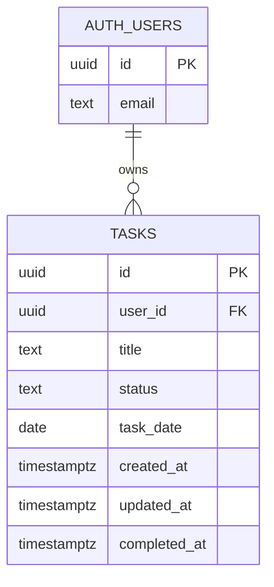

# Database Schema

Platform: Supabase (PostgreSQL). Applied in Phase 5 from `supabase/migrations/` (D-17).
One application table (D-04). Users are managed by Supabase Auth in `auth.users`, which we do not modify.

## 1. Entity Relationship



## 2. Table `public.tasks`

- **`id`** (`uuid`, required, default `gen_random_uuid()`): primary key.
- **`user_id`** (`uuid`, required, default `auth.uid()`): owner. Foreign key to `auth.users(id)` `ON DELETE CASCADE`.
- **`title`** (`text`, required): trimmed length 1–200 (VR-03).
- **`status`** (`text`, required, default `'pending'`): either `'pending'` or `'completed'` (D-06).
- **`task_date`** (`date`, required): the calendar day the task belongs to (BR-10). There is no time-zone conversion.
- **`created_at`** (`timestamptz`, required, default `now()`).
- **`updated_at`** (`timestamptz`, required, default `now()`): maintained by a trigger.
- **`completed_at`** (`timestamptz`, optional): set if and only if `status = 'completed'` (BR-12).

### Constraints
- `tasks_title_length`: `char_length(btrim(title)) BETWEEN 1 AND 200`.
- `tasks_status_valid`: `status IN ('pending', 'completed')`.
- `tasks_completed_at_consistent`: `(status = 'completed') = (completed_at IS NOT NULL)`.
- The `task_date` range (BR-14) is validated on the client only. "Today" depends on the user's time zone, which the database does not know (BR-10).

### Indexes
- `tasks_user_id_task_date_idx` on `(user_id, task_date)`. It serves every query pattern: tasks for a date, a date range, overdue tasks, and the full history ordered by date. It also speeds up RLS checks on `user_id`.

## 3. Row Level Security

RLS is **enabled**, and each operation has its own policy for the `authenticated` role. The `anon` role has no policy and therefore no access.
`(select auth.uid())` is used instead of `auth.uid()` because Supabase recommends this form for better performance (the value is computed once per query).

- **select:** `USING ((select auth.uid()) = user_id)`.
- **insert:** `WITH CHECK ((select auth.uid()) = user_id)`.
- **update:** `USING ((select auth.uid()) = user_id)` and `WITH CHECK ((select auth.uid()) = user_id)`. The user cannot move a task to another owner.
- **delete:** `USING ((select auth.uid()) = user_id)`.

## 4. Planned Migration `0001_create_tasks.sql`

```sql
-- Table
create table public.tasks (
  id           uuid primary key default gen_random_uuid(),
  user_id      uuid not null default auth.uid()
               references auth.users (id) on delete cascade,
  title        text not null,
  status       text not null default 'pending',
  task_date    date not null,
  created_at   timestamptz not null default now(),
  updated_at   timestamptz not null default now(),
  completed_at timestamptz,
  constraint tasks_title_length check (char_length(btrim(title)) between 1 and 200),
  constraint tasks_status_valid check (status in ('pending', 'completed')),
  constraint tasks_completed_at_consistent
    check ((status = 'completed') = (completed_at is not null))
);

create index tasks_user_id_task_date_idx on public.tasks (user_id, task_date);

-- Keep updated_at current
create or replace function public.set_updated_at()
returns trigger
language plpgsql
set search_path = ''
as $$
begin
  new.updated_at = now();
  return new;
end;
$$;

create trigger tasks_set_updated_at
before update on public.tasks
for each row execute function public.set_updated_at();

-- Row Level Security
alter table public.tasks enable row level security;

create policy "Users can read own tasks"
  on public.tasks for select to authenticated
  using ((select auth.uid()) = user_id);

create policy "Users can insert own tasks"
  on public.tasks for insert to authenticated
  with check ((select auth.uid()) = user_id);

create policy "Users can update own tasks"
  on public.tasks for update to authenticated
  using ((select auth.uid()) = user_id)
  with check ((select auth.uid()) = user_id);

create policy "Users can delete own tasks"
  on public.tasks for delete to authenticated
  using ((select auth.uid()) = user_id);
```

This migration is **apply once** (plain `create` statements). This SQL is a plan. In Phase 5 it is reviewed against the current Supabase documentation before it is applied.

## 5. Migration Strategy

- Each schema change is a new numbered file (`0002_...sql`). Applied migrations are never edited.
- Each migration file is idempotent where practical, or documented as "apply once".
- Migrations are applied in order through the Supabase SQL Editor, and each one is recorded in `PROGRESS.md` with its date.
- Before applying a migration to production, test it on a separate development project, or at least run the security tests (`TESTING_PLAN.md`, ST-xx) after applying it.
- Destructive changes (dropping columns or tables) require owner approval and a backup export first.

## 6. Not Included (by design)

- No `profiles` table (D-04).
- No statistics or snapshot tables (BR-11, D-09).
- No `deleted_at` column (D-12).
