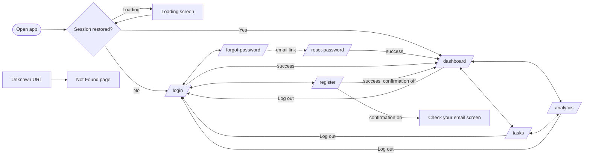
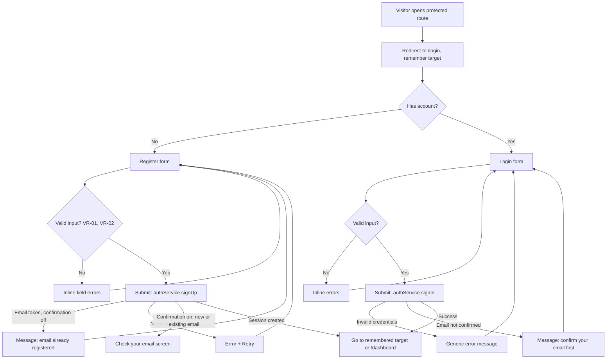
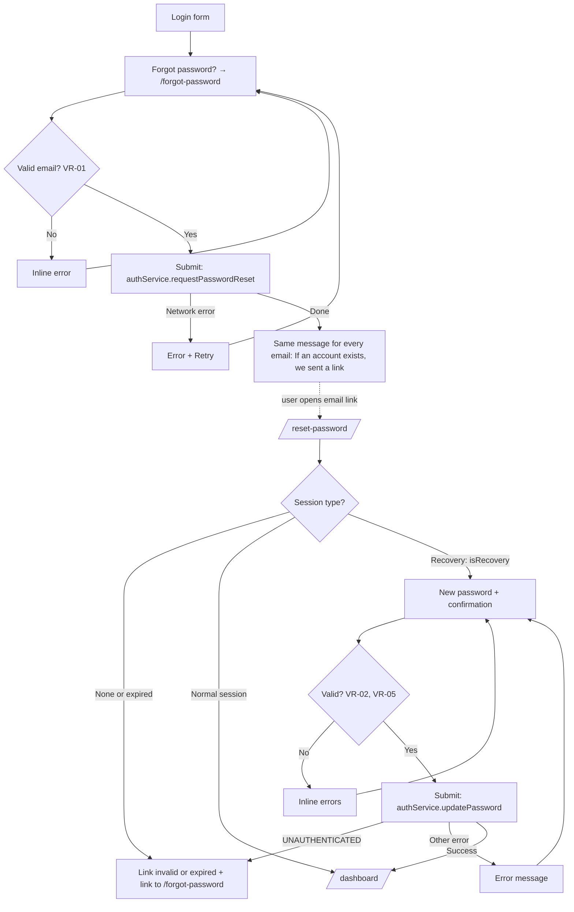
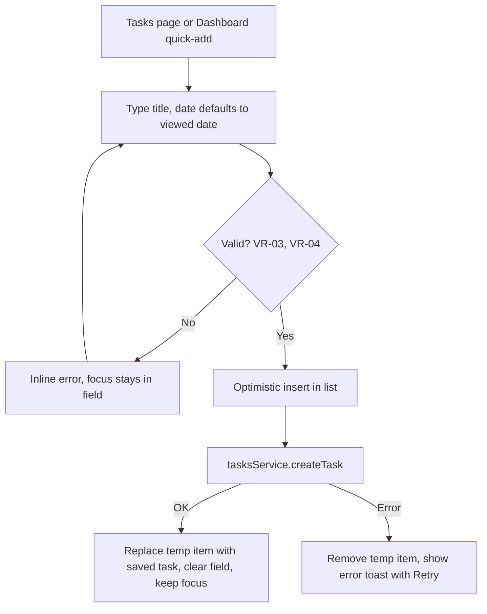
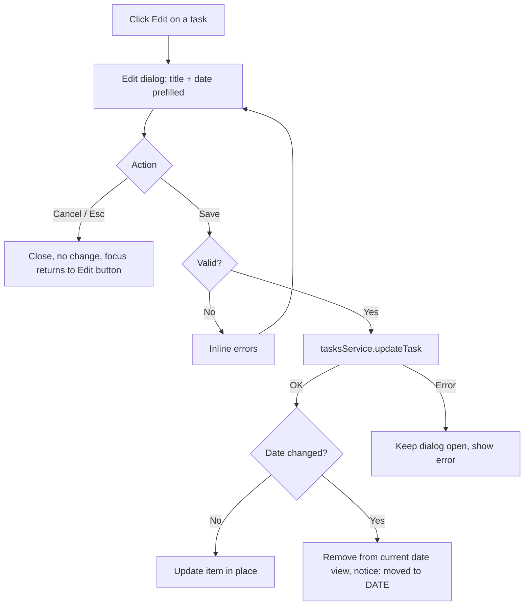
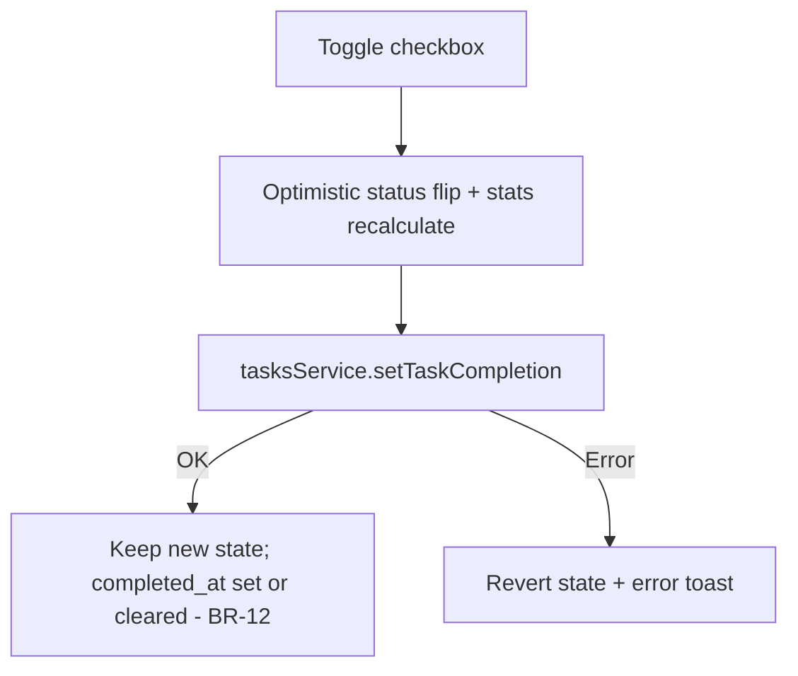
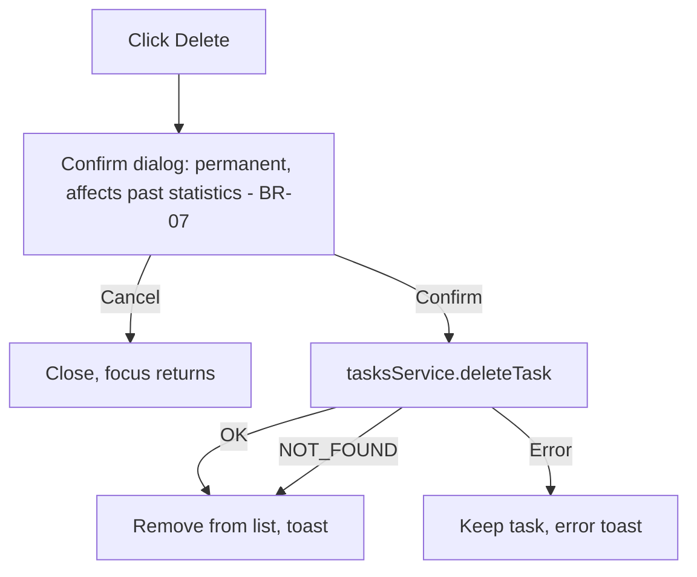
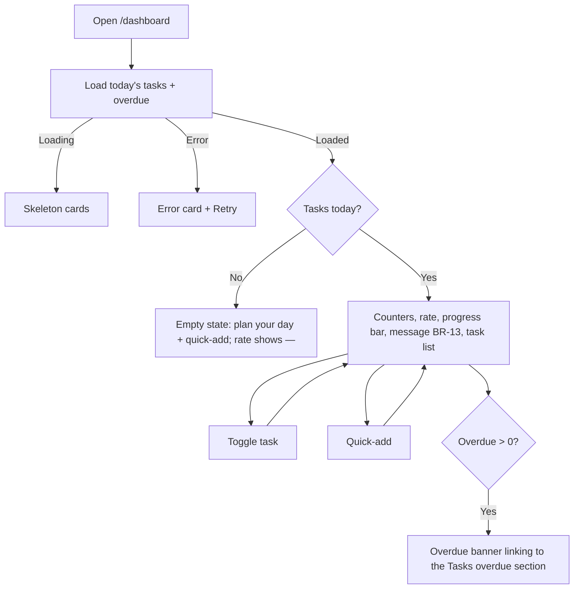
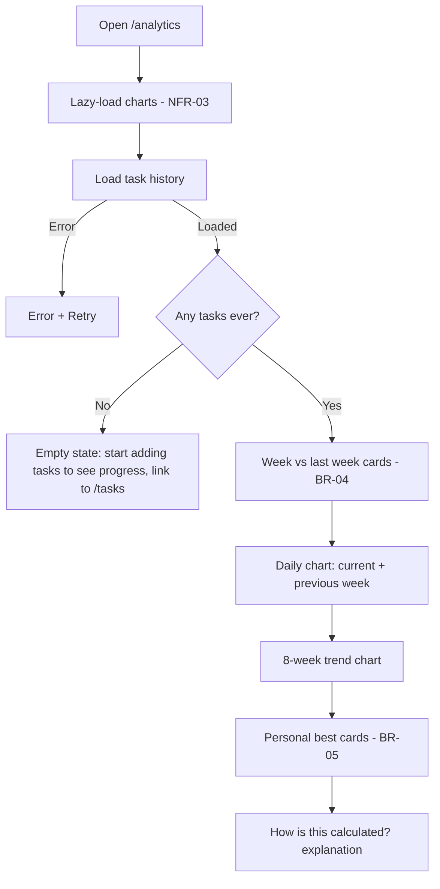

# User Flows

Stories: `USER_STORIES.md`. Rules: `PRD.md`. Screen layouts are added in Phase 2 (`DESIGN_SYSTEM.md`, P2-T01).

## 1. Navigation Map

Before Phase 5 there is no authentication: the app opens directly on `/dashboard` with a mock user (D-08).

## 2. Registration and Login

### Password Reset (US-26, D-19)

## 3. Task Creation

## 4. Task Editing and Rescheduling

## 5. Task Completion

## 6. Task Deletion

## 7. Dashboard Interactions

## 8. Analytics Navigation

## 9. Empty, Loading, and Error States

Every data view handles all three states:

- **Loading:** a skeleton placeholder. The layout does not jump. Loading text is announced politely to screen readers.
- **Empty states:**
  - Tasks for a date: "No tasks for this day" + add form focus.
  - Filter has no results: "No completed tasks yet" / "Everything is done" (depends on the filter).
  - Dashboard: no tasks today → invite to plan (BR-13).
  - Analytics: no history → explanation + link to Tasks.
  - Comparison: previous period has no data → "Not enough data" (BR-04, BR-06).
- **Errors:**
  - Network or server: a friendly message + Retry. Optimistic changes are rolled back.
  - Session expired: redirect to login with a notice.
  - Unknown route: Not Found page with a link to the Dashboard.
  - Unexpected crash: the error boundary shows a recovery screen with a Reload button.
